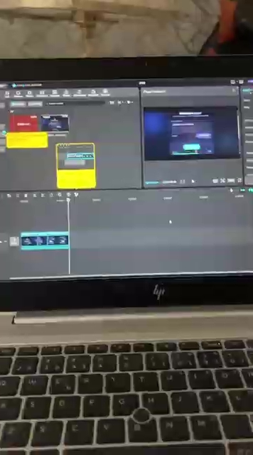
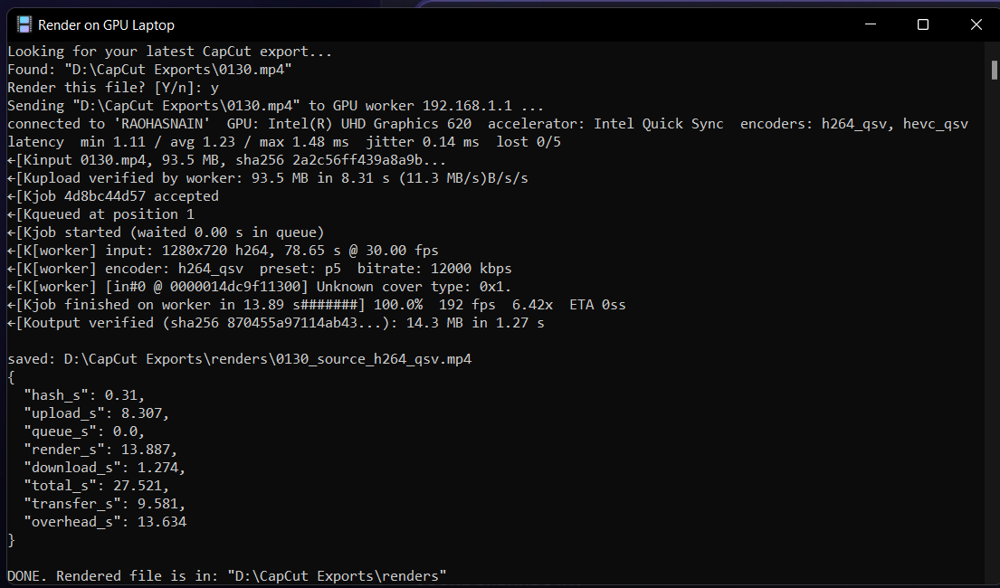
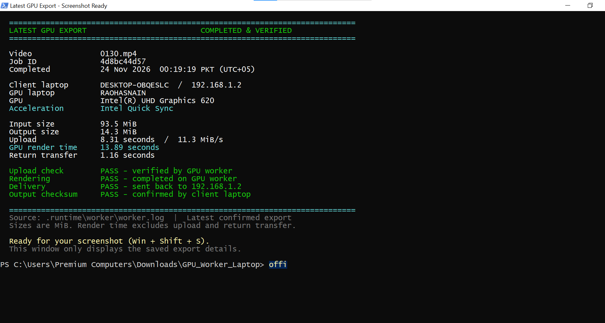

# Lab Mid: Remote GPU Rendering of a CapCut Clip over a Direct LAN Cable

| | |
|---|---|
| **Name** | Gulfam Ali |
| **Registration No.** | FA23-BSE-030 |
| **Course** | CSC-334 Parallel and Distributed Computing |
| **Date of run** | 24 Nov 2026, 00:19 PKT |
| **Code** | [client/](client/) · [server/](server/) · [common/](common/) |

A video edited and exported in CapCut on the client laptop is sent over a
direct Ethernet cable to a second laptop, encoded there on the GPU's hardware
video encoder (Intel Quick Sync), and the finished file is sent back to the
client. Both transfers are SHA-256 verified. No USB drive, router or internet
connection is involved.

## Demo video

Click the preview to watch the full demo on Google Drive.

<a href="https://drive.google.com/file/d/1bxh7_HC0YvGm0WkQsyjYMnPhuws50Hjr/view?usp=sharing">
  
</a>

▶️ **[Watch the demo video on Google Drive](https://drive.google.com/file/d/1bxh7_HC0YvGm0WkQsyjYMnPhuws50Hjr/view?usp=sharing)**

---

## 1. Setup

| | Client laptop (sender) | GPU laptop (worker) |
|---|---|---|
| Machine | `DESKTOP-OBQESLC` (Gulfam) | `RAOHASNAIN` (Rao Hasnain) |
| GPU | Intel HD Graphics 620 | **Intel UHD Graphics 620** |
| Hardware encoder | not used | **Intel Quick Sync** (`h264_qsv`, `hevc_qsv`) |
| LAN cable IP | `192.168.1.2 / 24` | `192.168.1.1 / 24` |
| Software run | `lan\3_RENDER_CAPCUT_CLIP.bat` (Desktop shortcut "Render on GPU Laptop") | `START_GPU_WORKER.bat` from `GPU_Worker_Laptop.zip` |
| Role | edit + export in CapCut, upload, receive result | receive, GPU encode, send back |

**Network.** One Ethernet cable directly between the two laptops. Static IPs, no
gateway, so Wi-Fi/internet stays separate. Link speed 100 Mbit/s
(measured ~11.3 MB/s). Worker listens on TCP port 5050, opened in Windows Firewall.

```
 Client laptop (192.168.1.2)                       GPU laptop (192.168.1.1)
 ┌─────────────────────────┐   Ethernet cable    ┌────────────────────────────┐
 │ CapCut  → export .mp4   │ ──── upload ──────▶ │ worker: verify SHA-256     │
 │ Render on GPU Laptop    │                     │ FFmpeg + Intel Quick Sync  │
 │ verify SHA-256, save    │ ◀─── result ─────── │ (h264_qsv) → output .mp4   │
 └─────────────────────────┘   TCP :5050         └────────────────────────────┘
```

---

## 2. Steps performed

1. **Cable and IP setup.** `lan\1_SETUP_LAN_THIS_LAPTOP.bat` on the client set `192.168.1.2`.
   `START_GPU_WORKER.bat` on the GPU laptop set `192.168.1.1`, added firewall rules for
   ping and TCP 5050, checked Python/FFmpeg/GPU encoder, and started the worker.
2. **Connection check.** `lan\2_CHECK_CONNECTION.bat`: ping replies under 1 ms, then
   an authenticated handshake reported worker `RAOHASNAIN`, Intel UHD Graphics 620,
   Intel Quick Sync, latency ~1.2 ms, 0/5 lost.
3. **Edit and export in CapCut** (MP4, H.264) to `D:\CapCut Exports`.
4. **Render.** Double-clicked **Render on GPU Laptop**. It found the newest export
   `D:\CapCut Exports\0130.mp4`, uploaded it, the worker encoded it on Quick Sync,
   and the result came back to `D:\CapCut Exports\renders\0130_source_h264_qsv.mp4`.
5. **Verification.** Upload hash checked by the worker, output hash checked by the
   client, and the worker's own log summary (server-side screenshot) shows PASS for all four stages.

---

## 3. Results

| Measure | Value |
|---|---|
| Job ID | `4d8bc44d57` |
| Input | `0130.mp4`, 93.5 MB, 1280×720 H.264, 78.65 s @ 30 fps |
| Encoder / settings | `h264_qsv` (Intel Quick Sync), preset p5, 12000 kbps, original resolution, audio kept |
| Upload | 93.5 MB in **8.31 s** (11.3 MB/s) |
| Queue wait | 0.00 s |
| **GPU render** | **13.89 s** at **192 fps**, **6.42× real time** |
| Download (result) | 14.3 MB in **1.27 s** |
| Total end to end | **27.52 s** |
| Transfer time (up + down) | 9.58 s |
| Network + hashing overhead | 13.63 s |
| Integrity | input and output SHA-256 both verified |

**Observations**

- The GPU laptop encoded the 78.65 s clip in 13.89 s, about 6.4× faster than real time,
  using the dedicated Quick Sync video engine instead of its CPU.
- At 100 Mbit/s the upload took 8.3 s, more than half the render time. A gigabit
  (Cat5e/Cat6) link would cut transfer time by roughly 10×. Offloading pays off
  most when the encode is heavy compared to the file size.
- The client laptop stayed free during the encode; it only sent and received the file.
- CapCut's own export still runs on the client. The worker performs the hardware
  encode of the exported clip, which is the transcoding step this project offloads.

---

## 4. Screenshots

### Client side (Gulfam, `DESKTOP-OBQESLC`, 192.168.1.2)

Render on GPU Laptop: finds the CapCut export, connects to `RAOHASNAIN`, uploads with
verification, shows live GPU progress (192 fps, 6.42×), downloads and verifies the
output, and prints the per-phase timings.



### Server side (Rao Hasnain, `RAOHASNAIN`, 192.168.1.1)

Summary of the same job from the worker log: Intel UHD Graphics 620 with Intel
Quick Sync. All four stages pass: upload check, rendering, delivery to 192.168.1.2,
and output checksum confirmed by the client.



More detail for each side: [client-side/](client-side/README.md) · [server-side/](server-side/README.md)

---

## 5. Files used

| File | Laptop | Purpose |
|---|---|---|
| [`GPU_Worker_Laptop.zip`](GPU_Worker_Laptop.zip) | GPU | Worker package: `START_GPU_WORKER.bat`, `server/`, `common/`, `lan_setup.ps1` |
| [`lan/1_SETUP_LAN_THIS_LAPTOP.bat`](lan/1_SETUP_LAN_THIS_LAPTOP.bat) | client | Static IP 192.168.1.2 on the cable (once) |
| [`lan/2_CHECK_CONNECTION.bat`](lan/2_CHECK_CONNECTION.bat) | client | Ping + worker handshake |
| [`lan/3_RENDER_CAPCUT_CLIP.bat`](lan/3_RENDER_CAPCUT_CLIP.bat) | client | Find latest CapCut export, render on GPU laptop, save result |
| [`lan/config.bat`](lan/config.bat) | client | Worker IP, port, token, bitrate |
| [`LAN_TESTING_GUIDE.md`](LAN_TESTING_GUIDE.md) | both | Step-by-step test procedure and troubleshooting |

To repeat the test, follow [LAN_TESTING_GUIDE.md](LAN_TESTING_GUIDE.md).
