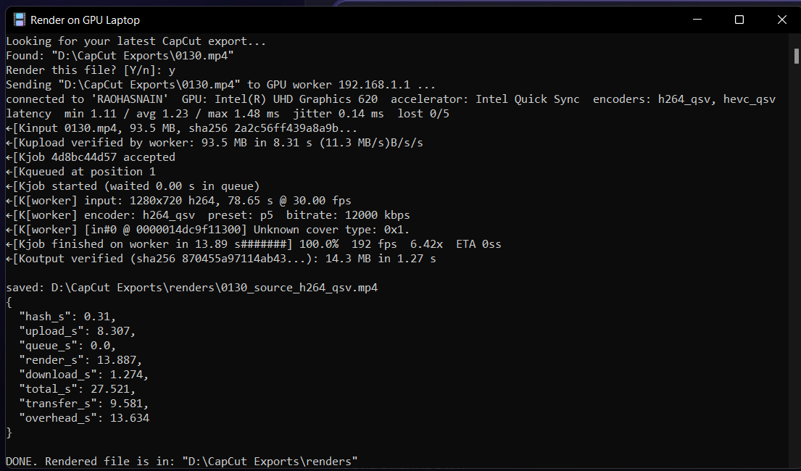

# Client Side: Gulfam (`DESKTOP-OBQESLC`, 192.168.1.2)

The client edits in CapCut, exports the clip, and hands it to the GPU laptop.

## What the screenshot shows

| Line | Meaning |
|---|---|
| `Found: "D:\CapCut Exports\0130.mp4"` | newest CapCut export picked automatically |
| `connected to 'RAOHASNAIN' GPU: Intel(R) UHD Graphics 620 accelerator: Intel Quick Sync` | authenticated handshake with the worker |
| `latency min 1.11 / avg 1.23 / max 1.48 ms ... lost 0/5` | link check over the cable |
| `upload verified by worker: 93.5 MB in 8.31 s (11.3 MB/s)` | worker matched the SHA-256 of the upload |
| `[worker] input: 1280x720 h264, 78.65 s @ 30.00 fps` | full clip received |
| `[worker] encoder: h264_qsv preset: p5 bitrate: 12000 kbps` | encoded on Intel Quick Sync |
| `job finished on worker in 13.89 s ... 192 fps 6.42x` | GPU encode speed |
| `output verified (sha256 870455a9...): 14.3 MB in 1.27 s` | client matched the SHA-256 of the result |
| `saved: D:\CapCut Exports\renders\0130_source_h264_qsv.mp4` | final file location |

## How it was run

1. CapCut → **Export** (MP4, H.264) to `D:\CapCut Exports`.
2. Desktop shortcut **Render on GPU Laptop** (runs `lan\3_RENDER_CAPCUT_CLIP.bat`) → `y`.
3. Output opened from `D:\CapCut Exports\renders\`.

Back to the [lab report](../README.md).
