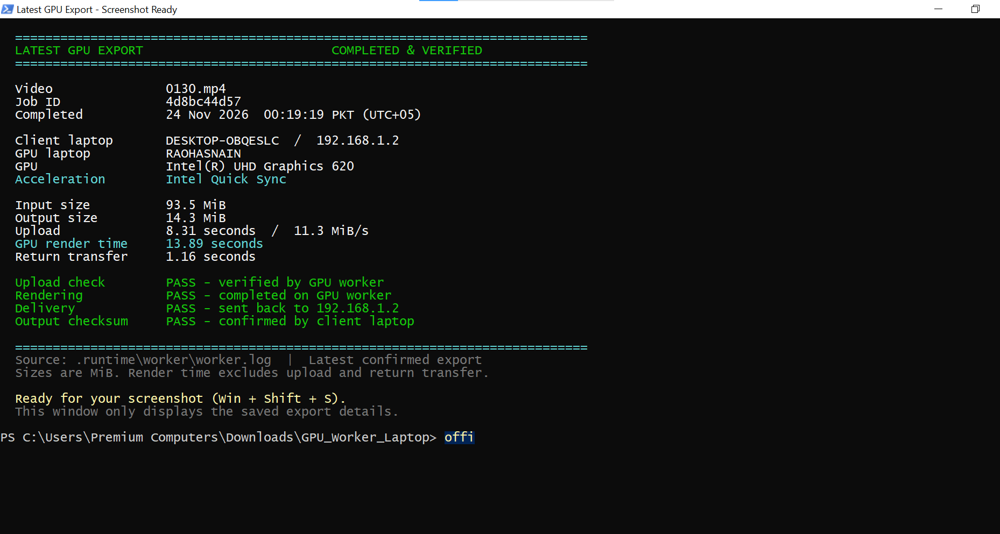

# Server Side: Rao Hasnain (`RAOHASNAIN`, 192.168.1.1)

The GPU laptop runs the render worker from `GPU_Worker_Laptop.zip`
(`START_GPU_WORKER.bat`) and encodes the clip on its Intel UHD Graphics 620
using Intel Quick Sync.

## What the screenshot shows

| Field | Value |
|---|---|
| Video | `0130.mp4` |
| Job ID | `4d8bc44d57` (same job as the client screenshot) |
| Completed | 24 Nov 2026, 00:19:19 PKT |
| Client laptop | `DESKTOP-OBQESLC` / 192.168.1.2 |
| GPU laptop / GPU | `RAOHASNAIN` / Intel UHD Graphics 620 |
| Acceleration | Intel Quick Sync |
| Input / output size | 93.5 MiB / 14.3 MiB |
| Upload | 8.31 s, 11.3 MiB/s |
| GPU render time | 13.89 s |
| Return transfer | 1.16 s |
| Upload check | PASS: verified by GPU worker |
| Rendering | PASS: completed on GPU worker |
| Delivery | PASS: sent back to 192.168.1.2 |
| Output checksum | PASS: confirmed by client laptop |

Values come from the worker log (`worker.log`). The job ID, sizes and timings
match the client side, which confirms it is the same job seen from both ends.

## How it was run

1. Extracted `GPU_Worker_Laptop.zip`.
2. Ran `START_GPU_WORKER.bat` as Administrator. It set 192.168.1.1, opened TCP 5050,
   detected Intel Quick Sync, and started listening.
3. Left the worker window open while the client sent the job.

Back to the [lab report](../README.md).
